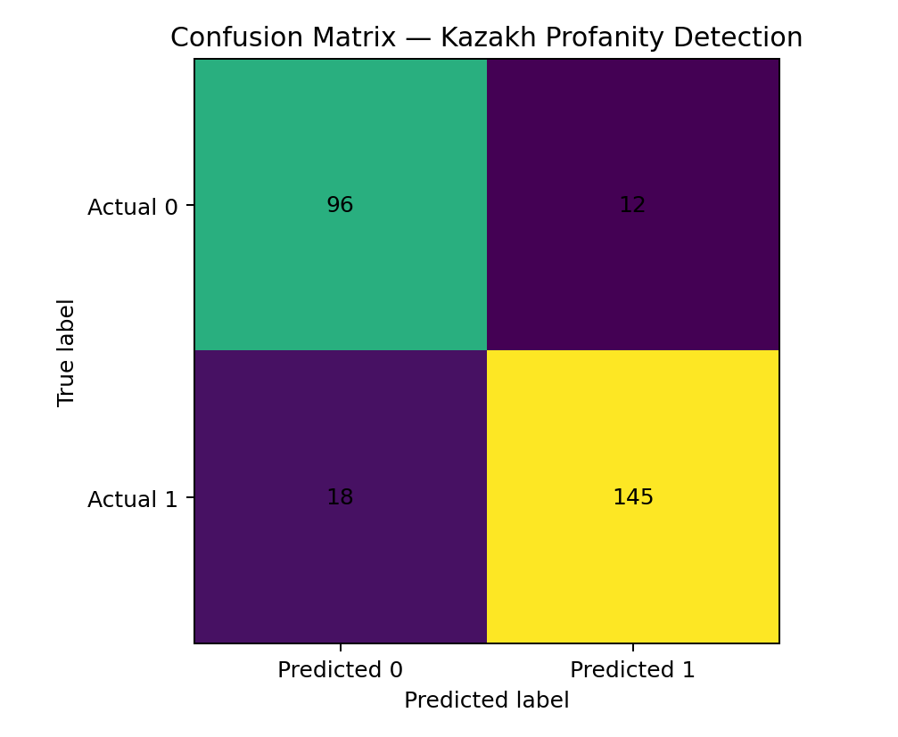

# Kazakh Profanity Detection

**Course:** DSSC5113 Algorithms of Computer Vision — Bonus Project  
**Task:** Binary classification of Kazakh customer reviews/comments for profanity.

## 1. Task definition

Input: one review or comment.  
Output:
- `0` — no profanity detected;
- `1` — Kazakh/Russian profanity or insulting language is present.

The model also returns the estimated profanity probability and the decision threshold.

## 2. Dataset and labeling

The project uses a manually curated subset of **3,061 reviews/comments** associated with the KazSAnDRA review resource. KazSAnDRA is a public Kazakh sentiment-analysis review dataset covering Appstore, Bookstore, Mapping, and Marketplace domains. Its original labels describe sentiment/ratings, not profanity. Therefore, the original sentiment labels are **not used** as profanity labels: the project subset was labeled for this specific binary task and manually inspected.

Sources:
- KazSAnDRA project: https://issai.nu.edu.kz/kazsandra/
- Official dataset repository: https://github.com/IS2AI/KazSAnDRA
- Dataset paper: Yeshpanov & Varol (2024), LREC-COLING: https://aclanthology.org/2024.lrec-main.844/

The dataset contains real review/comment text. **No synthetic examples were added.** The repository dataset includes source review IDs for traceability; it does not include reviewer names, phone numbers, or contact details.

### Labeling rules

- `1`: recognizable Kazakh or Russian profanity/insults; mixed Kazakh–Russian profanity; Latin transliteration; spelling variations; elongated letters; and masked profanity when the intended word is unambiguous.
- `0`: negative sentiment or dissatisfaction without profanity; neutral text; and words that look offensive but are used literally in context.
- Mixed-language comments are labeled `1` if profanity appears in either language.
- A negative review is not automatically profane.
- Ambiguous cases are reviewed in context by the annotator rather than assigned from a keyword match alone.

A manual audit corrected **23 labels**. The class distribution after correction is:

| Label | Meaning | Count | Share |
|---|---|---:|---:|
| 0 | No profanity | 1,503 | 49.1% |
| 1 | Profanity present | 1,558 | 50.9% |
| **Total** | | **3,061** | **100%** |

Example labels:

| Text | Label | Reason |
|---|---:|---|
| `Кымбаттап кетипти говно` | 1 | Russian profanity in a Kazakh comment |
| `Жамаан ойын` | 0 | Negative opinion without profanity |
| `Роналду мал ма` | 1 | Insulting use of `мал` in context |
| `Маңғыстауда мал жоқ па?` | 0 | Literal reference to livestock |

## 3. Data splitting and leakage checks

The curated split was retained rather than randomly regenerated.

| Split | Samples | Share |
|---|---:|---:|
| Train | 2,525 | 82.49% |
| Validation | 265 | 8.66% |
| Test | 271 | 8.85% |

- Exact normalized cross-split duplicates after lowercasing, punctuation/symbol removal, and whitespace normalization: **0**.
- Character TF-IDF near-duplicate pairs with cosine similarity `>= 0.90` across splits, using the same normalized text: **0**.
- The split was retained; no new random split was generated. The model training seed is `42`.
- TF-IDF vectorizers and the classifier are fitted on Train only. Validation is used for hyperparameter and threshold selection. Test is reserved for final evaluation.

These checks reduce duplicate-related leakage risk but cannot rule out every semantically similar comment. See `results/data_leakage_audit.json` for the audit summary.

## 4. Model and preprocessing

One trainable classifier is used: **word + character TF-IDF features with Logistic Regression**.

Why this model:
- It is lightweight and practical for a 3,061-example dataset.
- Word n-grams capture lexical patterns and short expressions.
- Character n-grams help with spelling variation, mixed scripts, elongated letters, and some transliteration.
- Logistic Regression provides a probability-like score and is easy to inspect and reproduce.

Text is lowercased by the vectorizers. Word TF-IDF uses 1–2 grams; character TF-IDF uses 2–5 character grams. No stemming or aggressive normalization is applied, so the model can retain spelling and character patterns. Long comments are processed as full strings; there is no transformer token limit or truncation. Unknown words contribute through character n-grams where possible.

Validation search: `C ∈ {0.1, 0.3, 1, 3, 10}`. The selected value is `C=3`. The decision threshold was selected by maximizing positive-class F1 on validation: **0.4453**. The model was fitted on Train; Validation was used for selection. The test set was evaluated only after selection.

## 5. Final test results

Held-out test size: **271** comments (108 class 0, 163 class 1).

| Metric | Result |
|---|---:|
| Accuracy | **0.8893** |
| Precision — profanity class (1) | **0.9236** |
| Recall — profanity class (1) | **0.8896** |
| F1 — profanity class (1) | **0.9062** |

Confusion matrix (rows = true class, columns = predicted class):

| | Predicted 0 | Predicted 1 |
|---|---:|---:|
| True 0 | 96 | 12 |
| True 1 | 18 | 145 |



Interpretation:
- False positive (12): a clean review is flagged as profane.
- False negative (19): a profane review is missed by the classifier.

See [`results/ERROR_ANALYSIS.md`](results/ERROR_ANALYSIS.md) and [`results/test_predictions.csv`](results/test_predictions.csv) for actual examples and analysis.

## 6. Setup

Python 3.11–3.13 is recommended. From the repository root:

```bash
python -m venv .venv
# Windows: .venv\Scripts\activate
# macOS/Linux: source .venv/bin/activate
pip install -r requirements.txt
```

## 7. Reproduce training and evaluation

The processed dataset is included at `data/kazakh_profanity_dataset.csv`.

```bash
python src/train.py --data data/kazakh_profanity_dataset.csv --output models
```

This trains candidate models on Train, selects `C` and the decision threshold on Validation, then evaluates the selected model once on Test. It saves the trained model, configuration, metrics, and test predictions.

## 8. Predict a new comment

```bash
python src/predict.py --text "Кымбаттап кетипти говно"
```

Example output:

```json
{
  "label": 1,
  "prediction": "profanity present",
  "profanity_probability": 0.864,
  "threshold": 0.4458
}
```

The probability in the example is illustrative; run the command to obtain the actual score from the saved model.

Python API:

```python
from src.predict import predict_text
print(predict_text("Жақсы қосымша, рақмет!"))
```

## 9. Limitations

- The dataset is small and manually curated; it may not represent the natural prevalence or full diversity of Kazakh profanity in production.
- Ambiguous words such as `мал` depend heavily on context. A bag-of-ngrams model cannot fully understand semantics.
- Rare Latin transliterations, diacritics, masked forms, and creative misspellings remain challenging.
- The reported probability is a model score, not guaranteed calibrated probability.
- Performance should be re-evaluated on a larger, independently collected sample before deployment.

## 10. Project files

```text
Kazakh_Profanity_Detection_Project/
├── data/
│   └── kazakh_profanity_dataset.csv
├── models/
│   ├── kazakh_profanity_tfidf_logreg.joblib
│   └── config.json
├── notebooks/
│   └── Kazakh_Profanity_Detection_End_to_End.ipynb
├── results/
│   ├── confusion_matrix.png
│   ├── test_metrics.json
│   ├── test_predictions.csv
│   ├── error_analysis.csv
│   └── ERROR_ANALYSIS.md
├── src/
│   ├── train.py
│   └── predict.py
├── requirements.txt
├── ATTRIBUTION.md
└── README.md
```

## Acknowledgment

KazSAnDRA is the source review resource. Please retain attribution to Rustem Yeshpanov and Huseyin Atakan Varol and follow the source repository's license/terms when redistributing data. AI assistance was used for code structuring and documentation; the project owner curated and manually reviewed the profanity labels and should be prepared to explain and modify the submitted code during the individual defense.
